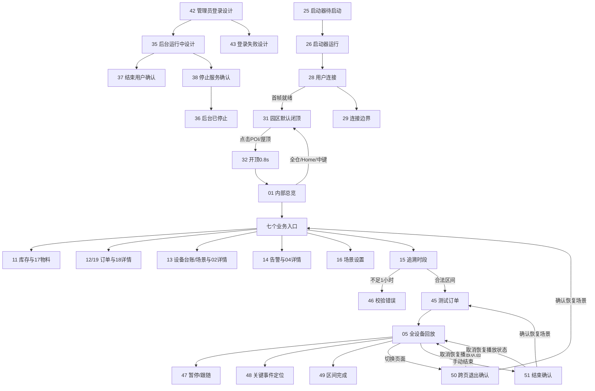

# SaasNew · 最新设计迁移清单

审计日期：2026-10-27。目标是将 Saas.pen 的全部 54 个页面/状态与 47 个可复用组件整理到 Figma；不是仅迁移七个导航页。该目录为迁移准备资料，不能作为已完成 Figma 上传的证明。

## 设计源优先级

1. **UE actual runtime screenshots + Content/GHSTwinUI/web + Tools/GHSTwinMotion**：Current warehouse business UI and latest motion/state behavior
2. **Source/Test roof/replay/camera/HUD and saved Zcool scene**：3D interaction, POIs, roof, replay, camera, current model shape
3. **Design/GHS_Twin_SaaS_Concept/Saas.pen**：Complete 54-board page/state inventory, editable components and approved unimplemented admin designs
4. **Design/GHS_SaaS_Interactive_20261026**：Reference interaction flows only; prototype simulations are not evidence of production integration
5. **Design/GHS_Warehouse_HUD**：Earlier separate NormalWarehouse HUD history; do not merge old V9 dual-sidebar style into SaasNew

## 全部页面与状态

| 编号 | 页面/状态 | 模块 | 交互 | 最新差异 |
|---|---|---|---|---|
| 00 | POI 与 HUD 设计系统 | foundation | 检查 POI 默认、悬停、选中、预警、故障、离线、待接入、区域和月台状态 | 沿用批准布局并核对实际数据 |
| 01 | 内部总览 / 仓库空间态势 | campus | 切换七个业务入口；点聚合标签展开成员；收起/展开侧栏 | motion、startup、roof |
| 02 | 点位选中 / AGV 设备详情 | campus | 切换运行状态/任务/事件；放大设备图；定位设备；进入追溯 | motion、agv-model |
| 03 | 聚合展开 / 成员分页与定位 | campus | 全部/预警筛选；成员分页；点击成员定位 | 沿用批准布局并核对实际数据 |
| 04 | 告警定位 / AGV 低电量 | campus | 定位关联充电位；确认告警并保留未恢复状态；进入追溯 | motion、agv-model |
| 05 | 订单追溯 / 全时段设备回放 | replay | 播放/暂停；拖动时间轴；倍率；±30 秒；关键事件；跟随设备；结束追溯 | motion、replay-trail、replay-ripple、replay-camera |
| 06 | 库位 POI / 原设计与未核验标记 | campus | 查看货位占用；打开独立示例物料；锁定货位反馈 | motion |
| 07 | HUD 详情组件 / 车辆与设施 | foundation | 切换叉车/堆高车/装卸车/充电设施详情；查看关联对象 | agv-model |
| 08 | 搜索与数据状态 / 边界反馈 | foundation | 搜索无结果清除筛选；历史无记录调整时间；失败重试；过期刷新；未知与离线区分 | 沿用批准布局并核对实际数据 |
| 09 | 交互路径 / 密度与动效规范 | foundation | 聚合→成员→设备→返回交互路径；检查减少动态效果 | replay-trail |
| 10 | 聚合预警 / 从异常到设备 | campus | 从异常聚合筛选并定位设备 | 沿用批准布局并核对实际数据 |
| 11 | 库存 / 数量与货位分布 | business | 区域目录选择；样例库存搜索；占用图例交互；格位选择 | motion |
| 12 | 订单 / 今日出入库作业 | business | 出入库切换；订单/物料搜索；状态筛选；仅异常；分页；订单详情 | motion |
| 13 | 设备 / 真实台账与场景映射边界 | business | 真实台账/场景模型切换；类型筛选；台账样例详情；未映射禁用定位 | motion |
| 14 | 告警 / 分级队列与处理状态 | business | 按级别/确认状态筛选；当前/恢复队列；告警定位；确认操作 | motion |
| 15 | 订单追溯 / 时段查询 | replay | 开始/结束时间选择；1/2/4小时快捷选择；至少1小时校验；索引订单 | motion、replay-trail |
| 16 | 场景 / 即时图层与库容设置 | business | 全仓/俯视/货架/地堆视角；四图层开关；标签密度；货架/地堆比例滑条；恢复默认 | motion、roof |
| 17 | 库存明细 / 物料与货位详情 | business | 返回库存保留筛选；库存样例列表；独立物料样例详情 | motion |
| 18 | 订单详情 / 拣货与设备联动 | business | 返回原订单列表；定位来源货位/目标月台/执行设备；查看物料；追溯 | motion |
| 19 | 订单 / 入库切换状态 | business | 入库订单状态；切回出库保留日期 | motion |
| 20 | 设备 / 充电设施切换状态 | business | 设施状态筛选；仅空闲；充电设施详情；定位关联AGV | motion、agv-model |
| 21 | 导航内容地图 / 七个业务入口 | foundation | 七业务入口导航；检查跨页返回路径 | 沿用批准布局并核对实际数据 |
| 22 | 业务状态 / 空值权限与确认反馈 | foundation | 库存空结果/加载/失败；订单零值；锁定记录；已确认未恢复 | 沿用批准布局并核对实际数据 |
| 23 | 设备搜索 / 匹配结果与定位 | campus | 输入查询；上下箭头选结果；Enter定位；Esc收起 | agv-model |
| 24 | 仓库切换 / 当前与接入边界 | campus | 打开仓库选择器；选择当前GHS；无其他接入仓库说明 | 沿用批准布局并核对实际数据 |
| 25 | 像素流服务启动器 / 待启动 | launcher | 程序/端口/分辨率/画质配置；访问模式切换；高级参数；启动服务(原型模拟) | streaming-scope |
| 26 | 像素流服务启动器 / 运行中 | launcher | 访问页；在线会话；日志；停止服务确认 | streaming-scope |
| 27 | 启动器 / 配置与异常状态 | launcher | 端口冲突/路径错误校验；画质与高级参数；启动停止反馈；停止确认 | streaming-scope |
| 28 | 像素流访问 / 自动连接进度 | connection | 五阶段连接进度模拟；帮助；首帧进入场景 | streaming-scope |
| 29 | 像素流访问 / 连接边界反馈 | connection | 管理员结束/超时/停止/重连/其他标签/自动播放阻止；对应重试或允许播放 | streaming-scope |
| 30 | 搜索与选中 / 中文输入和控件规范 | foundation | 中文输入法合成期间不误定位；搜索匹配；类型/模型选中；放大缩小与全仓 | 沿用批准布局并核对实际数据 |
| 31 | 园区默认 / 唯一主仓库 POI | campus | 主仓库唯一POI；点击查看内部；展开业务面板 | motion、startup、roof |
| 32 | 点击开顶 / 0.5 秒溶解流程 | campus | 点击主仓库开始开顶；动画期间内部拾取禁用；完成后显示内部；全仓恢复 | roof |
| 33 | 主仓库 POI / 当前交互规范 | foundation | POI默认/悬停/开顶规范；主动设备定位先开顶 | roof |
| 34 | 场景设置 / 即时控制与库容状态 | foundation | 四图层蓝色开关；80%/100%初始比例；关闭货物禁用滑条；全仓和恢复默认区别 | roof |
| 35 | 像素流后台 / 运行中 | administration | 服务参数保存；在线用户操作；结束单用户；停止服务；访问页 | streaming-scope |
| 36 | 像素流后台 / 已停止 | administration | 无用户空态；启动服务；服务参数保存 | streaming-scope |
| 37 | 像素流后台 / 结束用户连接 | administration | 结束连接确认；取消；单用户移出列表 | streaming-scope |
| 38 | 像素流后台 / 停止服务确认 | administration | 停止服务确认；取消继续；停止全部会话 | streaming-scope |
| 39 | 像素流后台 / 状态与参数反馈 | administration | 启动/停止过程；失败/重试；端口校验；参数待重启提示；高级参数；无用户；停止失败；断开通知 | streaming-scope |
| 40 | 像素流访问 / 管理员结束连接 | connection | 管理员结束连接说明；手动重新连接 | streaming-scope |
| 41 | 像素流访问 / 服务已暂停 | connection | 服务暂停说明；检查服务状态 | streaming-scope |
| 42 | 像素流后台 / 管理员登录 | administration | 管理员账号密码；登录；打开用户连接页 | streaming-scope |
| 43 | 像素流后台 / 登录失败 | administration | 登录失败保留账号；重新输入密码；重试登录 | streaming-scope |
| 44 | 园区总览 / 库容说明展开 | campus | 库容说明打开/关闭；示例与真实数据分离 | motion |
| 45 | 订单追溯 / 4 个测试订单 | replay | 4个测试订单选择；修改时段；开始全部设备回放 | motion |
| 46 | 订单追溯 / 最短 1 小时校验 | replay | 少于1小时错误；输入纠正；索引按钮不可重复 | motion |
| 47 | 订单追溯 / 暂停与设备跟随 | replay | 暂停/播放；跟随人工叉车；取消跟随；地堆全景；剩余路线全部/选中/关闭 | motion、replay-trail、replay-ripple、replay-camera |
| 48 | 订单追溯 / 关键事件定位暂停 | replay | 关键事件分页；事件点击定位并暂停；时间轴标记跳转 | motion、replay-trail、replay-ripple、replay-camera |
| 49 | 订单追溯 / 区间播放完成 | replay | 停止在区间终点；从头回放；结束追溯 | motion |
| 50 | 订单追溯 / 跨页停止确认 | replay | 跨页停止确认；继续恢复原播放状态；停止后执行原导航 | motion |
| 51 | 订单追溯 / 手动结束并恢复场景 | replay | 手动结束确认；恢复进入前场景；取消保持回放 | motion |
| 52 | 订单追溯 / 查询与恢复边界 | replay | 索引加载/空/失败；夏令时不存在/重复时刻；恢复失败重试 | motion |
| 53 | 订单追溯 / 1440 设备与时间轴 | replay | 1440×900响应式回放面板；时间轴与侧栏同步伸缩 | motion、replay-trail、replay-ripple、replay-camera |

## 必须同步的最新差异

### motion

生产侧栏已使用 React Bits 数字与 ECharts SVG 图表；以当前实际页面内容/颜色/布局为准。导航选中高光仅点击或键盘激活后移动；hover仅显示本按钮淡蓝反馈。

证据：`Content/GHSTwinUI/web/app.js`、`Tools/GHSTwinMotion/src/runtime.jsx`、`Tools/GHSTwinMotion/src/charts.js`、`Tools/GHSTwinMotion/README.md`。

### startup

初始保持#F4F6F9底色，正式视口和字体准备完毕后呈现；禁止展示1×1临时纹理中的业务内容。ready握手即时发送；字体失败可回退，尺寸条件不得超时绕过。

证据：`Content/GHSTwinUI/web/startup.js`、`Content/GHSTwinUI/web/index.html`。

### roof

手动点击POI/屋顶开顶0.8s，设备定位快速开顶0.5s，恢复合顶0.55s；从中央向两侧平滑打开，长蓝色拖尾。闭顶及过渡中内部标签和拾取锁定。纠正旧画板统一写0.5s的描述。

证据：`Source/Test/GHSWarehouseRoofComponent.h`、`Source/Test/GHSWarehouseRoofComponent.cpp`。

### replay-trail

只显示移动中人工叉车当前任务尚未行驶的路线；统一#356BFA主题蓝前端到#8BB9FF淡蓝透明尾端。18cm宽，2.25m实段+0.75m空段，1.2m/s流动，不要白色流光。不同叉车路线以高度3cm+i×0.8cm错开；暂停保留当前剩余路线；静止/取放/故障无路线；卡车无路线。

证据：`Scripts/ghs/replay_repair_trail_material.py`、`Source/Test/GHSOrderReplayActor.cpp`、`Source/Test/GHSOrderReplaySimulation.h`。

### replay-ripple

追溯叉车底座扩散圈使用与路线一致的可辨认主题蓝渐变；普通场景人工叉车不显示追溯扩散圈；暂停和跳转跟随同一回放时钟。

证据：`Scripts/ghs/replay_ripple_shader.py`、`Source/Test/GHSOrderReplayActor.cpp`、`docs/changes/2026-10-26-replay-ripple-visibility.md`。

### replay-camera

回放全景覆盖地堆作业区；跟随可左键旋转/滚轮缩放，右键平移无效，不脱离跟随；面板收展与时间轴宽度同步平滑变化，保持镜头连续，无跳帧重定位。

证据：`Source/Test/GHSWarehouseCameraPawn.cpp`、`Source/Test/GHSOrderReplaySession.cpp`、`Content/GHSTwinUI/web/replay-overlay.js`。

### agv-model

按实际设备ID匹配外观：AGV-01为白色扁平AGV，STACKER-04为当前场景蓝色小车。2/23页使用AGV-01的充电区场景和白色模型缩略图，4页使用STACKER-04的地堆作业区场景与蓝色模型缩略图；不能把STEP蓝色外壳误标为AGV-01。本次仅整理设计素材，不修改生产模型。

证据：`Design/SaasNew/runtime/detail-alignment-validation.json`、`Design/SaasNew/runtime/assets/agv.png`、`Design/SaasNew/runtime/assets/stacker.png`。

### streaming-scope

本地Windows启动器和连接页已有实现，按Tools/PixelStreaming实际功能核对；35–43后台/管理员登录保留设计状态，不把独立React原型的模拟操作标成已部署后台。

证据：`Tools/PixelStreaming/README.md`、`Tools/PixelStreaming/server/README.md`、`Tools/PixelStreaming/launcher/MainForm.cs`、`Tools/PixelStreaming/player/app.js`、`Design/GHS_Twin_SaaS_Concept/streaming-admin-design.md`。

## 动效与交互参数

| 动效 | 参数 | 行为 |
|---|---|---|
| 导航选中高光 | 250ms | 点击/键盘确认导航；hover不迁移选中高光；焦点有可见边框 |
| 指标数字 | 680ms | 首次或数值更新；从当前值滚动到新值；编号/时间/未知值不滚动 |
| 环图展开 | 600ms | 进入相应页面 |
| 柱条生长 | 450ms | 进入相应页面 |
| 折线描画 | 650ms | 进入相应页面 |
| 图表数据更新 | 350ms | 实际数据变化；复用实例及稳定数据ID，不变数据不重播 |
| 面板条目错峰 | 300ms；错峰35ms，上限210ms | 轻移淡入；遥测刷新不重播 |
| 业务页面切换 | 120ms退出 + 200ms进入 | 保留旧内容直到淡出结束；快速导航以最后目标为准 |
| 原生侧栏收展 | 420ms | 搜索框与时间轴同步收展；追溯相机保持连续 |
| 原生菜单 | 160ms | 淡入和短距离移动 |
| POI合并拆分 | 120ms | 原地淡入淡出，不跨屏飞行 |
| 相机定位 | 850ms | 默认值，实际飞行范围700–1000ms；屋顶完成打开后才定位 |
| 减弱动态效果 | 0ms | 立即收敛，不循环动画；隐藏页面暂停无意义绘制 |

## 数据与可用性约束

- 337,783 现存、336,006 可用、156 货主、14,373 SKU；叉车台账82/正常62/禁用20/维修中0为用户核验的静态摘录，不是实时接口。
- 库容饼图、48格货位、订单、告警和示例遥测保留“数据未核验”；真实容量/单位/场景映射缺失不补造。
- 原生顶部搜索只查询场景目录，业务面板搜索只查询已提供样例；不能在设计注释里声称两者已经完整贯通。
- 主仓 POI文字为“GHS · 主仓库 / 点击查看”，不恢复“普通仓库”。顶栏地址与America/Los_Angeles实时时钟保留。
- 默认屋顶闭合，内部标签与拾取关闭；全仓恢复屋顶，定位内部设备先开顶再定位。
- 图层四开关即时生效；货架80%、地堆100%只调整可视货物，不修改业务库存；货物图层隐藏时禁用滑条并保留数值。
- 回放区间至少实际3600秒；4个测试订单复用5叉车+3卡车数据。跟随可旋转缩放但不可平移；点击关键事件暂停并跳转，保留当前跟随目标。
- 回放退出必须确认；取消恢复原播放状态，确认先恢复场景再执行原操作一次。
- 25–29为现有启动器/连接流程；35–43后台登录保持获批设计状态，不宣称真实管理员认证/云端部署已完成。
- 蓝色用于交互/选择，橙色用于等待/待处理，红色用于故障，灰色用于禁用/未知；不以新霓虹光效替代原风格。

## 页面导航与状态流

## Figma 文件组织与验收

1. 00 封面与版本说明
2. 01 设计系统与公共组件
3. 02 园区与空间交互
4. 03 库存订单设备告警
5. 04 订单追溯完整流程
6. 05 像素流启动器与连接页
7. 06 后台与登录设计
8. 07 交互与动效规范

保留可编辑文字、矢量、组件与实例；3D场景可以用当前项目截图作为位图底图。不要将54张整页PNG当成完成可编辑迁移。每张画板保留原编号与来源ID，注明当前实现/设计待开发边界；交互写入原型连线与附近的行为说明。最终需记录Figma文件URL、54页覆盖表、47组件迁移情况、图源日期、缺失资源清单与实际保存/原型预览证据。

旧 `Design/GHS_Warehouse_HUD` 是不同阶段设计，保留档案，不纳入当前SaasNew的双侧栏视觉。源文件与历史导出不删除。后续经用户批准的设计以SaasNew为维护入口，源代码仍是运行行为核对依据。
