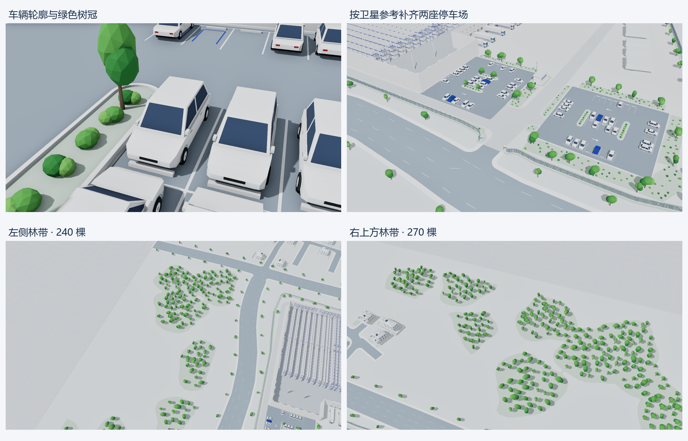

# GHS 园区 CAD 校准与车辆植被细化版

本目录保存 2026-10-21 车辆、植被及停车场细化版本的布局、Blender 源模型和 FBX。**以 `park_manifest.json`、`site_geometry_report.json`、`cad_layout.json` 为当前数据依据**；本页统计已覆盖此前版本。目标关卡是 `/Game/Maps/GHS_CAD_NormalWarehouse_ZcoolSmartFactory`。

## 数据来源与配准

原始文件：`D:/UEPro/Test/CADGis/cadmapper-muscoy-california-us/cadmapper-muscoy-california-us/cadmapper-muscoy-california-us.dxf`。

SHA-256：`82ad1a249acc8f1bacf6fb313f8c422c316663ff987738e789b15e448283a9ec`。提取程序只读源文件，保留 419 个建筑原始 MESH、185 条线要素及其中 79 条车辆道路中心线。道路与住宅位置按 DXF 校准；园区边界、入口及建筑细节参考用户卫星图，属于展示重建，不是宗地测绘。

仓库 `1eb6` 的三个角点将 CAD XY 仿射映射到现有仓库 UV：

| 锚点 | CAD 原始 XY | 目标 UV，米 |
| --- | --- | --- |
| backSW | `(423.8071, 444.0218)` | `(0, 0)` |
| backNE | `(843.2883, 645.0026)` | `(465.7344, 0)` |
| frontSW | `(483.48, 319.9706)` | `(0, 137.16)` |

```text
u = 0.9023064585475312*x + 0.43404048546294594*y - 575.1273211364305
v = 0.4305234644027491*x - 0.8985758812574258*y + 216.52837930202614
```

三个锚点精确吻合，长边和短边尺度调整约 `+0.127%`、`−0.361%`。其余仓库角点仍有最大约 `2.22 m` 的源轮廓差异，未局部扭曲修补。**现有仓库主模型不重建、不旋转、不缩放；生成时跳过 `1eb6`**。

DXF 的 `$INSUNITS=4` 标称毫米，但仓库数值约 `465.14 × 137.66`、普通住宅约 `10–21`，坐标按米解释，不乘 `0.001`。全部 419 个建筑高度恰好为 `3 m`，是未经验证的默认拉伸，不当作实测高度。源地形高程仅保留作参考，场景采用平坦展示地面，跨线桥局部抬升约 `6.1 m`。

原许可全文保存于 [LICENSE.txt](LICENSE.txt)，同时嵌入 `cad_layout.json.attribution`。地图数据归属 OpenStreetMap contributors；高程来源包含 USGS NED 与 NASA SRTM。分发源数据须随附原许可文本。

## 当前生成结果

以下数值读取自本轮最终 manifest 与完整几何报告：

| 项目 | 当前值 |
| --- | --- |
| 按材质／用途合并的网格 | 21 |
| 三角面 | 741,077 |
| 住宅 | 338：299 栋 CAD 位置 + 39 栋 Gray Pine 卫星补房 |
| 住宅形式 | 四种双层组合、坡屋顶及太阳能板；高度约 7.45–7.81 m |
| 住宅车道 | 335 条连接街边，3 户只保留短入口 |
| 园区围栏 | 周长约 1,533.835 m；除两个命名入口外连续闭合 |
| 入口 | SW Main gate、NE Service gate；4 个门柱、2 个门卫 |
| 住宅最小道路净距 | 1.065 m，按实际定向包围矩形检查 |
| 小车 | 140 台：62 台轿车 + 78 台紧凑型 SUV；每车 584 三角面 |
| 园区小车泊位 | 82 个；其中 51 个停有车辆，另有 89 台住宅车道车辆 |
| 挂车 | 52 个泊位、27 台停放挂车 |
| 树木 | 815 棵多簇阔叶树，包含两片林带的 510 棵 |
| 低矮灌木 | 191 组，独立于树木统计 |
| 停车场端头绿岛 | 4 处，上下两场各 2 处 |
| 受检停车车辆最小道路净距 | 0.356 m；受检车辆共 167 台 |
| 围栏在非入口处横穿道路 | 0 m |
| 既有月台货车纳入围栏范围 | 52 台 |

北侧 39 栋补房标记为 `satellite_infill`，沿 CAD 已有 Gray Pine 道路及支路布置，不能当作 CAD 测得建筑。每栋记录包含位置、朝向、来源、实际包围矩形、净距和车道状态。前草坪按邻近住宅分区，侧后院采用约 `1.4 m` 浅灰墙；共用车道口仅输出合并面，避免重复共面几何。

道路使用相切圆角、持续弧长标线和合并路面。交叉口从合并后的外边界生成路缘，不再依赖首版各段抬高来掩盖交叉路缘。跨线桥和坡道标线跟随道路高程。实际圆角半径仍受相邻线段限制，不等同于货车扫掠轨迹验算。

本轮沿用已配准的 79 条 CAD 道路中心线，不为填满停车场移动道路。修复路面合并过度平滑将邻近道路间空地误填成连接面的情况：合并圆角参数由 `4.0 m` 调为 `3.8 m`，保留道路中心线，恢复上场西侧连续 6 个泊位。按照用户停车场卫星近景，上场中央车辆沿 `v` 排列，下场中央车辆沿 `u` 排列，方向相差 90°；周边补齐边缘车位、4 处圆头绿岛、入口及沿街绿化，取消 2 个与车道冲突的候选泊位。绿岛距道路最小 `0.597 m`，泊位边缘最小道路净距 `0.029 m`，种植区域与道路重叠面积为 `0 m²`。

车辆使用明确的引擎盖、斜前后风挡、车顶、轮胎及轮毂、轮眉、后视镜、车灯和保险杠；保守停车占地为 `4.53 × 1.854 m`。树冠改为不对称的圆润多簇轮廓，使用深、中、浅三档绿色与独立树干色，保留低模表现。左侧和右上方新增两片林带分别为 240、270 棵，是用户要求的环境补充，**不是卫星逐棵测绘**。森林生成避让 CAD 道路、住宅／车道、园区边界及 10 条水道，其中水道保留至少 `18 m` 的净距策略，实际最小树冠水道净距约 `18.603 m`。

## 坐标与资产

- 局部 `u/v` 使用米；`u` 沿仓库长轴，`v` 指向装卸前场。
- Blender：`X=u−239.33385`、`Y=−(v−60.24019)`、`Z` 向上。
- FBX：`axis_forward=-Y`、`axis_up=Z`；UE 原点、单位缩放导入后为厘米：`X=(u−239.33385)*100`、`Y=(v−60.24019)*100`。
- 硬化地坪为 `−4 cm`，地面标题区域 `u=189.5…277.1、v=147.9…159.7` 保持避让。
- `GHS_Park_Source.blend`、`SM_GHSPark_*.fbx` 是可重建资产；`campus_plan_preview.png` 是几何预览，不能替代 UE 实际渲染。

## 复现与验收状态

完整步骤见 [园区扩展说明](../../../docs/ghs-park-expansion.md)。生成侧使用 Blender 5.2 / Python 3.13，`shapely==2.1.2` 安装到 `Saved/ParkRefinement/python_deps`；**UE 运行时不需要 Shapely**。

顺序为 `extract_park_cad.py` → `build_park_geometry.py` → 编辑器内 `apply_park_expansion.py` → `validate_park_expansion.py` 与截图；保存后另做 `validate_park_saved.py` 新进程重载及 `verify_park_runtime.py` 运行回归。

已有本轮离线证据：

- `Saved/ParkRefinement/CAD/validation.json`：源顶点／面／线一致、DXF 哈希未变、仿射往返误差小于 `1e-9 m`。
- `Saved/ParkRefinement/CAD/CAD_registered_uv.png`、`CAD_warehouse_alignment.png`：配准总图和局部。
- `Saved/ParkPolish/blender_geometry.log`：本轮 21 网格、741,077 面的导出记录。
- `Saved/ParkPolish/vehicle_detail_report.json`、`vegetation_validation.json`、`forest_validation.json`：车辆几何、树冠及林带检查。
- `Saved/ParkPolish/parking_independent_review.json`：上下停车场方向、车位、端头绿岛及道路避让复核。
- `site_geometry_report.json`、`park_manifest.json`：当前净距、围栏闭合与道路合并检查。

本轮已于 2026-10-21 完成 UE 导入、保存、独立进程重载与实际运行验收。最终导入为 21 网格、741,077 三角面；334 个原对象的网格、材质、标签、变换和实例数据比对通过，旧 NormalWarehouse 地图哈希保持不变。

1920×1080 / 2560×1600 全景、面板收展、AGV-07 选择和详情、复位清除选中、货架及地堆聚焦共 **14 项运行检查通过**，设备与设施注册表仍为 106 / 56。10 张 UE 近景逐项复核了车形、树冠、停车场开口及林带道路净空；旧 Review 图片已覆盖，本轮地图、manifest 与 15 张图片的哈希写入 [验收摘要](Review/acceptance.json)。



本轮没有重新打包 EXE，也没有进行多人像素流或稳定 60 FPS 性能测试。
