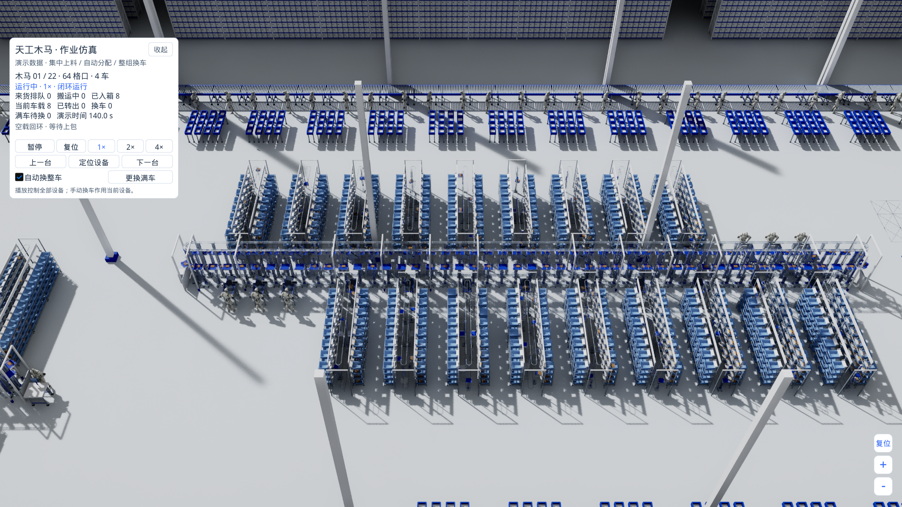

# MPR 仓库内部 CAD 复核与修复说明

本次依据原始 `平面布局图_MPR规划图V1.1_ALL-IN-ONE_0921.dxf` 修复现有关卡 `/Game/Maps/MPR_CAD_Warehouse_B50B57` 的货架与建筑构造，保留工业蓝白 SaaS 材质。原图 SHA-256 为 `c316aafe183162c5bef636885b59cc1000c3eecf50d8be645490b4716c6af863`；原 CAD 不修改，不新建关卡，不覆盖共享 GHS 模型和材质。

**交付状态：已保存到原 MPR 关卡；独立重载、9 组固定相机截图、15 秒原生帧率及 16 项播种机回归检查通过。证据见 [验证汇总](validation/summary.json)。图纸未确定部分仍见下文，不将推断当作实测尺寸。**

## 本次修改与依据

| 部分 | 实际构建内容 | 可追溯证据与整合入口 |
| --- | --- | --- |
| [货架](racks/README.md) | 按原图六类立面恢复 16、17+1、20、9、5、7 层架的梁高、层数、货物包络和通道开口。建立 15 个模型变体及 3 级 LOD；2867 个原实例逐一按 CAD handle 映射，保留原变换。 | `racks/rack_specs.json`、`cad_elevation_evidence.json`、`placement_manifest.json`、`mesh_manifest.json` |
| [墙与门](architecture/README.md) | 补齐 6 段漏提隔墙，合计 14.29033 m；补齐 80 扇人行门（34 扇外门、46 扇内门）。为 32 个外部门洞局部切割 7 面外墙，保留原 74 个大门洞。 | `architecture/cad_architectural_spec.json`、`mpr_interior_architecture_patch.json`、`fbx_validation.json` |
| [柱与楼梯](structure/README.md) | 从嵌套建筑底图核对柱截面；纠正 3 处“双柱被建成中间单柱”，补建 142 个独立柱体，合并重复截面后形成 303 个可见柱截面体。补齐南北入口 18 组楼梯与平台。 | `structure/detail_audit.json`、`structural_completion_manifest.json`、两张 CAD 证据图、`fbx_validation.json` |
| [窗与墙洞](windows/README.md) | 按 CAD 建立 102 片玻璃及框架，其中外墙窗洞为 41 个；局部替换 4 面外墙和办公隔墙，替换原来重叠、位置简化的 3 组玻璃带。05/15 外墙在已补人行门版本上继续切窗，保持门洞。 | `windows/cad_windows_manifest.json`、`reference_shell_manifest.json`、`fbx_validation.json` |

货架三视图位于 INSERT `2DA39F`，图面比例 3 仅为排版比例；物理尺寸以块内英寸换算，不将模型尺寸再乘 3。立柱名义高 9.144 m，加底板后为 9.154 m。144 英寸架的框外宽 3.81 m、深 1.0668 m；192 英寸通道框外宽 5.0292 m。

## GHS 同款货物与材质

货物细节复用 `Scripts/ghs/build_refined_rack_cargo.py` 的 `carton/pallet` 几何规则，经 `Tools/MPRWarehouse/mpr_ghs_cargo_geometry_20261112.py` 适配到 MPR 的 CAD 包络：箱体倒角、灰色封箱带、黑色标签，以及托盘底梁、支块与面板。颜色继续使用现有 GHS 工业蓝白材质角色；没有修改共享材质。

16 层每架保留 256 个 CAD 小件箱，20 层为 360 个；17+1 层保留 306 个小件箱及 3 个地面托盘货位。5/7 层、17+1 地面及 9 层较大货物包络内采用分层小纸箱装载，避免大块无细节立方体；9 层不擅自增加 CAD 未画出的托盘。包络内纸箱数量属于视觉装载，不是新增 CAD 货位数。

7 层架原图一处 22 英寸货物包络与上梁相交；保持原梁标高，将该处显示货高由 0.5588 m 调整为 0.542002 m，留出 5 mm 间隙。原始尺寸与此显示修正分别记录在规格及 `mesh_manifest.json`，没有反改 CAD。

## 未确定项与高度边界

- **27 个 F16 通道架**：原图缺少对应通道正视图，暂保留标准架顶部 4 根梁，首梁顶 6.8616 m、梁底净空 6.7854 m，明确标记为推断。平面 ACI 3 对应 F16 也由六种规格及分区推断，不能称为明确文字图例。
- **2 个混合通道**：`2CFE06`、`2CFECC` 两端分别邻接 20 层与 9 层架，无法唯一判型，保持 `Unresolved`。两种通道没有共同梁标高，因此仅建共同立柱和深向支撑，不虚构跨通道横梁或货物；所需最低净空按较大值 5.210463 m 记录。
- 192 英寸通道宽度有平面依据，但沿用相邻类型立面属于推断；9 层货物深度暂按 42 英寸架深表达。9 层、7 层英文标题与实际梁数冲突时，以实际线条为准。
- 门高 2.1 m、隔墙高 3.3 m、柱高 12.2 m、外窗框 z=1.325～3.875 m、室内窗框上缘 3.2 m 均沿用现有展示尺度，不是平面 CAD 测出的立面标高。楼梯按现有内外地坪高差 1.2 m 分为 8 个踢面；扶手及构件断面同属展示参数。
- 北侧一组明确的楼梯没有对应门符号，保留楼梯平面而不擅自增门。长办公隔墙是否应通至屋面、消防与其他竖向构造，仍需立面或现场资料确认。不能据此声称仓库全部构造已经“完美还原”。

## 设备保留与验证状态

本次修复不改原播种机代码、资源、输送循环及分拣逻辑。工人与中央传送投放设备由 `AMPRSorterSimulationActor::BeginPlay()` 调用 `BuildWorkers()`、`BuildCentralDistribution()` 在运行时生成；仅查看未运行的编辑器场景不能判断这些对象缺失。原相机、屋顶交互和园区景观不属于本轮修改对象。

已记录的离线检查包括：货架 45 个 FBX 回读及尺寸/梁位检查，最大包围盒误差小于 0.00043 mm；建筑 10 个 FBX 回读、288 条人门洞和 222 条大门洞射线；结构柱顶、踏面和平台接触检查；窗系统 6 个 FBX 回读、102 个玻璃中心与 369 条窗洞射线。对应结果保存在各子目录 manifest/validation 文件中。

UE 独立重载后的原资源包 1942 个均保持原 SHA-256；59 个货架实例组共 2867 个货架仍保留原位置、旋转与缩放。播种机 14 项编辑配置精确保持，运行验证确认 256 名 CAD 工人可见、22 台播种机、96 辆料框车和 120 个中央载具。

cad64、cad120 均完成满载等待、整车撤出、交接离场、空车到达、对接和恢复收货；自动调度多台换车及全程中央循环通过。代码、布局和原设备资源未改动。

固定 1920×1080 全景、单 UE 进程、15 秒原生 CSV 实测：修改前 41.92 FPS，修改后 42.19 FPS；播种区镜头 88.22 FPS。该结果只代表本机视角下的原生渲染，不代表 Pixel Streaming，也不代表厂家真实产能。

已查看纸箱/标签细节、各类货架及通道、窗洞内嵌玻璃、门与楼梯平台衔接以及工人/中央装置实际画面。原有深通道照明仍偏暗。本次换车诊断截图采用大步推进，可能残留时域重建痕迹，不作为平滑运动的视频证据。全部 9 组对比相机参数完全一致，精选原尺寸画面与 CSV 收录于 `validation/`；完整原始截图及状态位于 `Saved/MPR/interior_cad_20261112/`。

