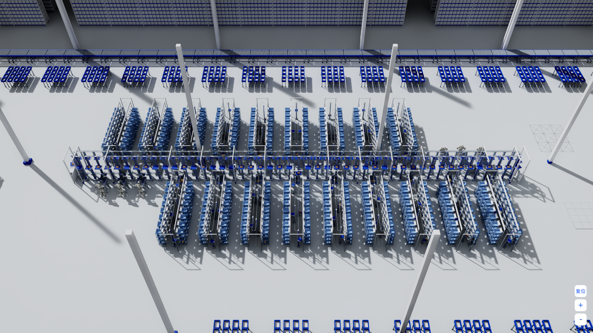
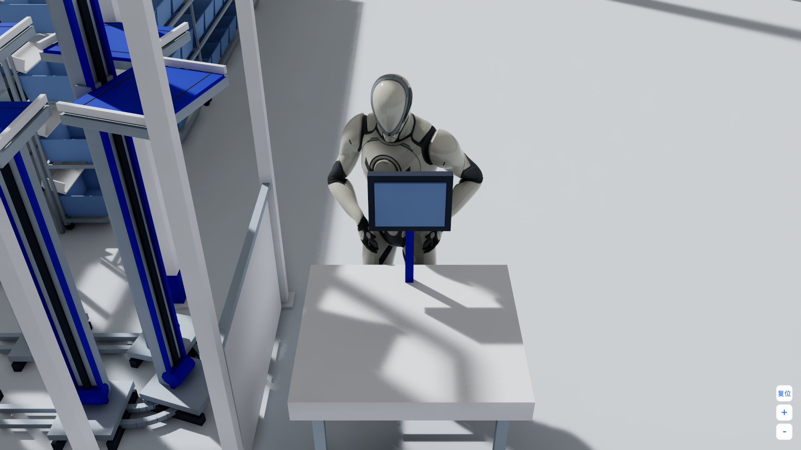

# MPR 人员范围与运行性能验收

已完成原生验证和归档。沿用原关卡 `/Game/Maps/MPR_CAD_Warehouse_B50B57`，没有新建关卡。

运行时取消生成 249 名播种区外 CAD 人员，保留六名投料人员和 `2CCF61` 端台人员。22 个整车更换人员槽位按原流程出现：共 29 个组件，常态 7 人、换车时最多 8 人；完整 256 人 CAD 来源不删改。

代码仅补回正常显示 LOD 的更新，并避免对不动的料框车重复提交 Transform/渲染脏标记。保留官方 Manny 网格、材质、动作骨骼计算、固定步长调度、连续环线和货物归属。

以下是人员删减、LOD、提交缓存以及同轮货架侧移后的合计实测，不能把全部增益归因于代码优化。每个固定镜头预热 10 秒、原生 CSV 采样约 15 秒，1920×1080；统计保留全部边界帧和峰值。

| 固定镜头 | 平均 FPS（前 → 后） | GPU 平均 ms（前 → 后） | 帧时间 P95 ms（前 → 后） |
| --- | ---: | ---: | ---: |
| 全仓俯视 | 47.23 → 83.97 | 20.34 → 11.11 | 23.15 → 13.04 |
| 货架近景 | 88.06 → 92.22 | 10.61 → 10.15 | 12.57 → 11.81 |
| 播种区 | 70.32 → 87.29 | 13.39 → 10.72 | 15.59 → 12.58 |

`manifest.json` 包含实际相机位置/角度、每项原生统计、原字节 SHA-256、gzip SHA-256 与归档路径。CSV 的均值、中位数、P95/P99、峰值、超预算帧数及 FPS 均在归档时独立重算；GPU 使用 UE RHI 的 `GPUTime` 和正值 GPU pass 时间戳。

## 验证状态与失败记录

- 自动化 33/33 通过；独立原生 LOD 远 → 近 → 远及出屏返回验证通过，固定端台姿势与六位投料人员骨骼/根变换/手掌位置保持。
- `after/20261112T121131Z` 的报告原样保留 `success=false`。三个正式性能采样已完成，其后旧诊断把投料姿势重复提交计数误当成位移变化，触发 `AssertionError: far`。这些 CSV 通过完整性、哈希、相机、分辨率和原生时间戳复核，不能把该整轮报告说成成功。
- 独立修正后的 `after/20261112T122126Z` LOD 诊断 `success=true`，没有覆盖前述失败报告。
- 完整 sorter 工作流与独立料框车缓存诊断分别成功后才允许 `--finalize`。前者保留原 16 项流程及人员筛选检查，后者检查复位时 96 车重新提交、120 次静止更新零提交，以及两类整车更换各阶段的实际提交与姿态一致。两进程避免嵌入 Python 额外大报告读回干扰，覆盖范围不减少。工作流自身的性能镜头不同，不与上表三镜头混用。

## 场景身份与比较边界

优化前地图 SHA-256：`1af91bb69aeb9643a14b33dad7239f8d300c8e29318a85b48e84737d0c5ecf23`。

优化后地图 SHA-256：`67cec0faee74dd8f38e7c74c4b305aa9bd2dc0c7558efc1ed131bc4ad034a659`。

哈希差异来自已独立验证的 91 列 / 2392 个货架实例侧移；原材质、网格、LOD/culling、设备、仿真配置和镜头配置由货架修改白名单保护。两次实测的实际相机与分辨率一致，但不是只改变一项因素的实验。

这里只证明本机单次原生运行结果，不代表 Pixel Streaming、多用户并发、网络延迟或厂家吞吐指标。

## 归档与复核

`evidence/*.gz` 保存必要报告和 CSV 原字节，`previews/` 保存少量原始 PNG。报告中的其他 Saved 图片/状态文件路径是采样时来源，不表示全部已归档；以 manifest 的 evidence 清单为准。不含地图备份、构建产物或大体积全场景扫描。

```powershell
python Tools/MPRWarehouse/archive_mpr_optimization_20261112.py --verify
```

重新归档前先运行 `--check-inputs`，完整工作流结束后运行 `--finalize`。未成功、尚在运行或缺失必要输入时拒绝最终归档；已有归档原字节发生冲突也拒绝覆盖。




