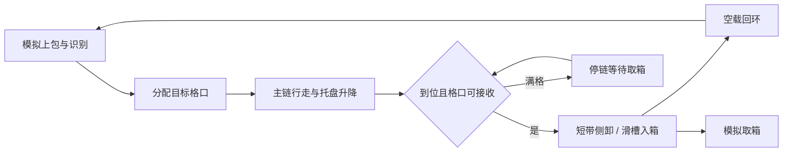

# MPR 天工木马播种工作流

已接入现有关卡 `/Game/Maps/MPR_CAD_Warehouse_B50B57`。运行关卡后，点击左上角「定位设备」：调用原 GHS 屋顶功能打开主仓，并用原 GHS 相机定位木马；「上一台 / 下一台」切换 22 台设备。

立柱沿水平闭环行走，托盘在立柱上独立升降，抵达目标列和层后侧向卸料，商品沿 20° 滑槽进入料箱，空载托盘回环。资料依据见 [原件摘录和官方来源](research/README.md)。

面板显示所选设备的统计和包裹目标。开始/暂停、复位、1×/2×/4×、自动取箱和清空满格对全部设备生效。复位后暂停且恢复 1×。自动取箱从首次入箱起计 12 秒；若正在卸料，等待卸完再取箱，避免包裹落点跳变。格口信号条与灯色是本次演示约定。

这是可交互的工作流程仿真，使用演示包裹和确定性目标序列，未连接真实订单、WMS/WCS 或 PLC。手册是 96 格装配版；本次保留场景已有的 18 台 64 格、4 台 120 格模型配置，共 1632 个显示格口，不据此认定实机安装容量。4 载具、40 cm/s 行走、55 cm/s 升降、0.5 秒识别、1.2 秒投料以及每箱 3 件都是展示参数。30 台短支机保留原状。

新增开放机架、立柱和托盘使用专用资源；原格口、22 台设备变换、其他 883 个场景对象和 1905 个原 Content 包均通过保存范围检查。布局内嵌在关卡 Actor，运行不依赖 Saved 中的文件。

## 运行画面与验证

- [16 秒工作流预览](validation/MPR_sorter_workflow.mp4)：固定 1920×1080 镜头，仿真时刻 55–71 秒；采样 6 帧/秒，视频编码为 30 帧/秒重复帧，不代表实时帧率。
- [64 格场景模型高层侧卸](validation/cad64_machine_00_A_level_3_unload.png)
- [120 格场景模型高层侧卸](validation/cad120_machine_18_B_level_3_unload.png)
- [UE 自动化](validation/ue_automation.json)：10 项通过，包含损坏布局拒绝、事件分步等价、货物守恒、满箱恢复和卸料/取箱互锁。
- [原生运行报告](validation/runtime.json)：13 项通过，双机型/双侧/高低层共 8 个投料视角、3 个阶段图、96 帧序列；完整画面与状态快照保留在报告所列 Saved 目录。
- [应用范围](validation/application.json) / [独立重载](validation/reload.json)：原图直接修改，新增一个原生控制 Actor，3 组 HISM 替换为专用开放机体。
- [几何回读](geometry_validation.json)：8 个 FBX、736 个箱口角点、41984 个托盘姿态；[包裹滑槽截面采样](validation/discharge_clearance.json) 共 16016 姿态无穿插。均是展示几何检查，不能替代制造间隙或动力学校核。
- [交互验收范围](validation/interaction_scope.json)：控制通过原生 API 验证，普通运行拒绝诊断时间推进；桌面鼠标点击因 Computer Use 应用授权超时未完成。

最终本地原生运行：i9-14900HX / RTX 5060 Laptop GPU、UE 5.8.4 / D3D12、1920×1080、22 台运行、面板显示、同一近景；关闭垂直同步及帧率上限，连续 15 秒平均 **125.32 FPS**，帧时 P95 **9.71 ms**。采样期间没有截图或手动推进。原始 CSV 已归档；这是该机器和该镜头的结果，不是生产节拍或云串流容量承诺。

## 复现入口

原生代码：`Source/Test/MPRSorterSimulation.*`、`MPRSorterSimulationActor.*`、`MPRSorterHUDWidget.*`。

`Tools/MPRWarehouse/build_mpr_sorter_sim_assets.py` 生成专用源模型，`verify_mpr_sorter_sim_assets.py` 独立回读。`apply_mpr_sorter_simulation.py` 的 `-MPRSorterApply` 只用于尚未接入的原快照，拒绝覆盖现有资源；无该标记时只验证已保存结果，不应对当前完成关卡重复应用。

`Tools/MPRWarehouse/verify_mpr_sorter_runtime.py` 在自有 `-game -RenderOffscreen -TwinDiagnostics` 进程中运行验收，不保存资源；`-MPRSorterCaptureSequence` 增加帧序列，`-MPRSorterVisualOnly` 只输出定向画面和帧序列。正式地图运行不需要这些诊断参数。
