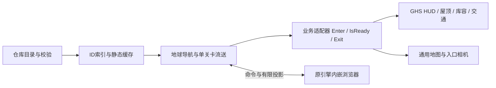

# 全球仓库入口与扩展边界

## 目标与现有系统

初始关卡 `/Game/Maps/GHS_GlobalWarehouse` 是常驻导航壳。Blender 真实地理地球只承担视觉；仓库位置来自 WGS84 目录，通过同一经纬度公式投影。业务页面继续由 UE 内嵌 CEF 呈现，轨道旋转、缩放、相机推进复用 `GHSWarehouseCameraPawn`。

设计源为 Figma SaasNew 的“04 · 全球仓库导航”，不覆盖原有仓库画板。原仓库 `GHS_CAD_NormalWarehouse_ZcoolSmartFactory` 作为首个目的地；原 `.umap` 不因入口开发而重写。

## 四个边界

1. **目录**：`Content/GHSTwinUI/data/warehouses.json` 声明稳定仓库ID、地址、WGS84经纬度、地图软路径、缩略图、区域、运行配置与能力。`GHSWarehouseRegistry` 负责校验和索引。HTML不指定关卡路径，命令只携带ID，UE仅从受控目录解析地图。
2. **导航与关卡生命周期**：地球Controller负责选择、预加载、飞行、遮罩、揭示、返回。旧目的地卸载结束后才激活新的目的地，限制驻留关卡，防止旧地图全局Actor扫描串入新仓库。
3. **业务适配**：`GHSWarehouseExperience` 定义进入、就绪、退出边界。`ghs` 适配现有仓库业务；`generic` 仅通用相机与返回。后续订单、设备、告警等模块接入适配器，不向地球控制器添加仓库ID分支。当前 `warehouse-ui` 是原GHS耦合业务的整体能力，`traffic`可独立开关；并不宣称原业务已完全插件化。
4. **视图与动效**：CEF接收首次目录及后续投影增量，维护ID索引。地球、相机和业务状态在UE；UI只做交互命令与展示。动效规范见 `Design/GlobeNavigation/MOTION_SPEC.md`。减少动画偏好必须同时关闭idle自转、缩短UI和镜头动效。

进入和返回均等待 CEF 全屏不透明遮罩的代号、尺寸回执及渲染缓冲后再切场景。旧回执、窗口尺寸变化、加载超时不会直接激活错误关卡。进入 GHS / generic 时恢复原相机56°视野，返回地球使用20°地图构图；旋转缩放仍复用同一个相机类。

遮罩握手使用 CEF 的 CSS 像素：`Slate局部尺寸 × 累计布局缩放 ÷ 原生窗口DPI`，与 UE `FWebBrowserViewport` 的转换一致。UI布局尺寸独立保留，不能直接与网页的 `innerWidth/innerHeight` 比较。原生端还检查实际浏览器几何是否完整覆盖入口视口；小型返回按钮的浏览器或迟到的旧回执均不能触发场景切换。

### 常驻相机契约

入口的 `PersistentLevel` 拥有唯一受控的 `GHSWarehouseCameraPawn`。适配器只调整它的镜头、姿态和限制，不替换或销毁控制器/相机。仓库中原有的 `AutoPossessPlayer=Player0` Pawn 可保留供单独启动地图使用；入口控制器拒绝流送子关卡的自动接管请求，避免卸载仓库时失去相机。

新增仓库的 `CameraActor.AutoActivateForPlayer` 必须关闭；这条引擎路径会直接改变 ViewTarget，绕过 Pawn 的自动控制检查。目标地图的蓝图与 LevelScript 不得调用 `UnPossess`、销毁常驻 Pawn、`RestartPlayer`、`OpenLevel` 或自行切换 ViewTarget。特殊视角通过适配器配置常驻相机。验收必须连续进入/返回，验证同一常驻相机、镜头恢复、业务 HUD 重建，以及屋顶/交通等旧状态释放。

地球全屏按钮切换本地独立 UE 游戏窗口，模式遵循 UE 显示设置；PIE 与离屏运行不会改变编辑器布局。Pixel Streaming 访客浏览器的全屏由外层播放器控制，内嵌 CEF 无法直接切换远端浏览器窗口。

## 资源预算

- 地球单材质，三级网格LOD：65024 / 16128 / 3968三角面，最高4K纹理；高程最多夸张球半径2.4%，属于地理示意，不用于测量。
- UE投影结果先聚合到最多256项，CEF再聚合到最多48个动态标记；预算收紧时扩大网格，保留所有可见仓库成员，不截断丢点。选中仓库独立保留，聚合点可展开对应列表。背面与离屏点位不创建点击目标。所有配置仓库仍可通过列表检索。
- 列表每页40条，搜索/区域/聚合筛选组合，节点数不随目录总量线性增长。
- 目录最多2000条，静态JSON缓存与ID索引只在初始化或目录变化更新；动态位置以20Hz发送。仓库模式停算地球投影，仅2Hz发送轻量状态。当前目录在进程启动时加载，线上热更新需新增版本化重新加载入口。
- 目的地按需加载并明确卸载；不将所有仓库地图同时加载，也不以“隐藏Actor”等同于资源已回收。GPU资源最终释放可能延迟到引擎垃圾收集和渲染线程完成。
- 不增加全屏WebGL地球副本；浏览器和UE不重复渲染相同3D内容。

## 新增仓库

1. 制作独立地图资产，原点、尺度、相机概览与环境参数满足对应运行配置的契约。关卡流送不会自动切换目标地图的GameMode。
2. 核实建筑级坐标并保留来源，给目录增加唯一ID、软地图路径、缩略图与运行配置。不能用城市中心替代仓库位置。
   `cluster-` 与 `cluster:` 是区分大小写的聚合点保留前缀，仓库ID不得使用；未填写区域的仓库统一归入“未分区”。
3. 通用仓库先使用 `generic`、空能力列表及必填的 `entryCamera`（厘米单位的焦点x/y/z、distance、角度pitch/yaw）。例如 `{"x":0,"y":0,"z":0,"distance":20000,"pitch":-45,"yaw":-90}`，必须按实际地图校准。使用GHS专属功能的地图必须满足GHS标签、屋顶、库容及场景数据契约。不同业务流程新增适配器，而非复制入口代码。
4. 将地图加入 `Config/DefaultGame.ini` 的 `MapsToCook`。执行 `node Tools/GlobeNavigation/validate-catalog.cjs`；JSON中的路径本身不会让Unreal自动cook地图。
5. 执行坐标/目录自动化、进入与返回回归，之后做目标平台打包验收。可加载目录和Editor可打开地图，不等于Shipping包已经包含全部资源。

## 验证与扩展阶段

`Tools/GlobeNavigation/tests/policy.test.cjs` 用2000点验证前端预算、背面剔除、聚合与分页。UE `GHS.Globe.*` 验证目录和地理策略；独立 `-game -GlobeSmokeTest` 验证真实CEF、相机命令、仓库流送和返回，并保存截图。该入口不能关闭用户Editor或PIE。

当前目录包含 GHS 加州仓库与 MPR 新泽西仓库。多仓库目录压力测试验证算法预算，不代表2000个仓库地图的内容兼容性或服务器并发容量。后续功能扩大时，每个业务模块应有独立数据订阅、进入/退出清理及刷新频率预算；新增仓库不得默认全量订阅所有业务。

MPR（`mpr-nj`）地址为 `1001 W Middlesex Ave, Port Reading, NJ 07064, USA`，地图为 `/Game/Maps/MPR_CAD_Warehouse_B50B57`。POI、列表、详情卡及选择/进入交互复用 GHS 的公共视图；场景通过 `generic` 适配器进入，空能力列表避免启用加州仓库专属业务。从全球入口进入时，默认视角按用户 2026-11-06 最后确认的斜俯视参考图校准，主仓位于画面左中部、铁路保留在右侧。入口焦点为 `[9410.439688,3040.512713,0]` cm，距离 `58029.207224` cm、俯角 `-40.561438°`、偏航 `-112.838687°`，沿用通用相机的 56° 视野；对应视点约 `[26521.625,43669.599,37734.249]` cm。2548×1473 原生渲染已对照参考图验证。该配置只作用于全球入口，不改写独立仓库地图或编辑器视角。缩略图使用该场景 2026-11-06 的原生概览截图。

MPR 经纬度 `40.568197,-74.242175` 使用 [Woodbridge Block 1095 / Lot 1.01 的公开地块定位](https://njpropertyrecords.com/property/1225_1095_1.01)，地址由 [Prologis 业主资料](https://prologis.getbynder.com/m/30d8742808ae0f7d/original/Prologis-Port-Reading_1001-Middlesex-Avenue.pdf)交叉核对。该点用于全球导航，精度为仓库场地定位，尚非测绘楼心；未使用城市中心替代。

编辑目录时由相邻的 `warehouses.schema.json` 提供编辑器字段提示。新增业务能力必须同步实现适配器、目录能力白名单与测试；不允许仅在JSON写一个尚未实现的功能名。GHS现有订单/设备功能仍封装在 `warehouse-ui`，下阶段按业务域逐步拆分。真实库存接口未接入全球目录时显示 `—`，不把设计稿示例数字当实时数据。

线上性能验收应记录：首次可交互耗时、选中到预加载完成、进入/返回耗时、连续切换后的内存/显存、UE帧耗时、CEF刷新负载及Pixel Streaming实际解码帧率。当前开发机结果不能替代目标服务器容量结论。
