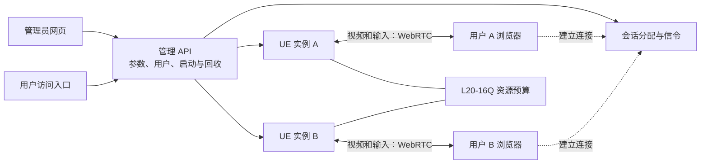

# NVIDIA L20-16Q：UE 项目浏览器串流方案调研

调研日期：2026-10-29（北京时间）。对象：当前 UE 5.4 项目及 `Package_Windows/Windows/TestGame.exe`。服务器 GPU 按用户最新提供的 **NVIDIA L20-16Q** 评估，操作系统沿用此前提供的 Windows Server 2025 信息，本次未远程复核。

需求：网页打开、每人独立操作与视角、1080p60 / 1080p30、可管理实例启停和用户连接。此次仅核对公开资料与本地项目文件，没有安装新方案、启动服务或进行压测。

## 1. 选择建议

**有其他开源方案，但本次没有找到已证实能在“当前 UE 项目 + L20-16Q + Windows Server 2025 + 每人独立会话”的同等条件下，比官方 Pixel Streaming 更流畅的现成替代品。**

建议保留 **UE 原生渲染与 Pixel Streaming 编码链路**。短期沿用已有加固版 peer-stream，完善管理与网络配置；如果需要统一官方前端接口、诊断和后续升级路线，可评估官方配套基础设施。为了流畅性直接更换到远程桌面方案，目前证据不足，迁移成本反而明确存在。

可按以下顺序选择：

| 优先级 | 选择 | 对本项目的实际价值 |
| --- | --- | --- |
| 当前优先 | 现有加固版 peer-stream + UE 原生 Pixel Streaming | 复用已经集成的 Windows 包、浏览器输入、按用户分配实例和回收逻辑 |
| 官方标准化路线 | 与引擎版本匹配的 PixelStreamingInfrastructure + 业务管理服务 | 使用官方前端、信令和统计接口；版本适配仍需验证，不承诺提高帧率 |
| 实验备选 | MoonlightWeb | Windows 通用应用直接进浏览器，适合研究单会话捕获/编码表现；独立多用户路径尚有明确验证缺口 |
| Linux 平台路线 | Selkies，或 Wolf + 浏览器入口 | 适合建设通用应用/桌面平台，但需要 Linux 运行环境与会话隔离，迁移工作较大 |

这些是基于架构与当前项目状态的选型判断，不是性能排名。厂商或作者给出的低延迟数字，不等同于这台服务器运行本项目的结果。

## 2. L20-16Q 对选型的影响

**L20-16Q 是 Q 系列虚拟 GPU，配置显存为 16384 MB。** NVIDIA 将 Q 系列定位为虚拟工作站配置，需要相应 vWS 许可。表中“每张物理 GPU 最多 3 个同规格 L20-16Q”描述的是 vGPU 配置数量，不能解释成“当前这台虚拟机支持 3 名 UE 用户”。[NVIDIA vGPU 配置表](https://docs.nvidia.com/vgpu/latest/grid-vgpu-user-guide/virtual-gpu-types-grid-reference.html)

显存分配比例也不等于固定的算力比例。宿主机可采用不同的 vGPU 调度策略，编码容量也有独立配置/查询机制；不能把整卡 L20 的性能、48 GB 显存或编码器数量直接套用到当前虚拟机，也不能简单把整卡性能除以三。[NVIDIA 调度策略](https://docs.nvidia.com/vgpu/latest/grid-vgpu-user-guide/changing-vgpu-scheduling-policy.html)、[NVML vGPU 管理接口](https://docs.nvidia.com/deploy/nvml-api/latest/api/group__nvmlVgpu.html)

对本项目更有意义的条件是：

| 条件 | 为什么影响实际体验 |
| --- | --- |
| 图形驱动、WDDM、vGPU 许可正常 | GPU 被识别不等于 UE 的图形渲染和硬件编码都已就绪 |
| 当前虚拟机实际分配的渲染及编码资源 | 决定同场景多实例竞争时是否掉帧 |
| 每个 UE 实例的峰值显存与 CPU 开销 | 16 GB 显存由该虚拟机内的多个实例共同使用 |
| 公网有效上行、用户网络、TURN 路径 | 服务器能渲染 60 FPS，不代表用户能稳定收到并显示 60 FPS |
| 客户端硬件解码与浏览器 | 同样码流在不同终端上可能有不同解码延迟和丢帧情况 |

阿里云要求图形加速使用匹配实例与系统的 GRID 驱动。此前截图中出现过 MCDM，但本次不能认定它仍是当前状态；MCDM 是计算用途驱动模型，不能用该截图证明图形链路可用。[阿里云 GRID 驱动说明](https://help.aliyun.com/zh/egs/use-an-alibaba-cloud-marketplace-image-with-a-pre-installed-driver-to-load-a-grid-driver)、[Microsoft MCDM 定义](https://learn.microsoft.com/en-us/windows-hardware/drivers/display/mcdm)

官方 UE5.4 参考页支持 Windows 平台，但列出的已测试系统没有 Windows Server 2025。因此这个组合属于需要实际验收的部署环境，不能称为已被官方验证的组合。[UE5.4 平台与编码参考](https://dev.epicgames.com/documentation/en-us/unreal-engine/unreal-engine-pixel-streaming-reference?application_version=5.4)

## 3. 与 UE 直接相关的方案

| 方案 | 已确认的功能与定位 | 当前项目的适配判断 | 开源与维护情况 |
| --- | --- | --- | --- |
| [Epic PixelStreamingInfrastructure](https://github.com/EpicGames/PixelStreamingInfrastructure) | 官方网页播放器、输入、信令及相关基础组件；完整生产调度仍需业务服务 | 与 UE 结合最直接；当前包应匹配 UE5.4 分支 | 基础设施 MIT；UE 引擎本身另有许可。仓库持续更新，但 UE5.4 已不在维护支持范围 |
| [inveta/peer-stream](https://github.com/inveta/peer-stream) | 轻量前端/信令；一对一分配、自动启动、基础管理 | 我们已做本地加固适配，迁移工作较小；仍使用 UE 原生渲染和编码 | README 为 MIT；查询到的最后提交为 2025-10-03 |
| [8SFXIM5/pixelman](https://github.com/8SFXIM5/pixelman) | 管理端/渲染端、多机分配、GPU 监控、实例启停与回收 | 可借鉴管理逻辑；未找到 UE5.4 的明确兼容验证 | MIT；最后主分支提交 2023-06-26；认证、Docker、K8s 在 README 中仍为未完成项 |
| [AWS pixel-streaming-at-scale](https://github.com/aws-samples/pixel-streaming-at-scale) | AWS 上的实例伸缩、用户入口与云资源编排参考 | 基于 UE5.2 并依赖 AWS 组件，不适合直接搬到当前单台阿里云 Windows 主机 | MIT-0；查询到的主分支最后提交为 2023-12-12 |
| [Epic UnrealPixelStreamingOnAzure](https://github.com/EpicGames/UnrealPixelStreamingOnAzure) | React 管理台、多区域伸缩和部署脚本 | 可阅读设计；迁出 Azure 的改造量大 | MIT；作者明确已结束支持与维护 |

官方旧 `EpicGamesExt` 地址现在重定向至 `EpicGames`。必须按引擎版本选择分支；当前开发文档明确 UE5.4 及更早版本不受支持。换成最新网页库并不会自动把现有 UE5.4 程序升级为 Pixel Streaming 2，也不能保证协议兼容。[官方版本要求](https://github.com/EpicGames/PixelStreamingInfrastructure#versions)、[维护政策](https://github.com/EpicGames/PixelStreamingInfrastructure/blob/master/DEVELOPING.md)

peer-stream 的优势主要是集成简洁。没有查到它针对本场景与官方的同条件性能对照；前端代码少、信令服务轻，并不能直接推导 UE 渲染更快。它的上游脚本与我们本地加固版也应区分，不能把此前删除的原版执行/控制接口重新当作公网后台使用。[peer-stream 中文说明](https://github.com/inveta/peer-stream/blob/main/README-zh.md)、本地 [适配说明](D:/UEPro/Test/Tools/PeerStream/README.md)

**管理平台可以改善稳定性**：限制同时运行的实例、提前准备空闲实例、及时回收离线进程，可以减少资源争抢和等待。但这不等于改变了显卡能力。官方同样把生产伸缩交给部署方实现，并已在 UE5.5 废弃原来的简单 Matchmaker 方案。[Epic 部署与伸缩指南](https://dev.epicgames.com/documentation/en-us/unreal-engine/hosting-and-networking-guide-for-pixel-streaming-in-unreal-engine)

## 4. 能实现类似功能的通用串流方案

| 方案 | 浏览器访问 | 每人独立操作/视角 | 对当前 Windows UE 包的代价 | 建议 |
| --- | --- | --- | --- | --- |
| [MoonlightWeb](https://github.com/linckosz/moonlight-web) | 支持；已有自带捕获编码引擎 | 普通共享功能仍共享桌面；独立 Windows seats 需额外组件，作者明确未完成端到端验证 | 需要验证 Server 2025、虚拟显示、输入路由、会话隔离和生命周期 | 作为实验备选 |
| [Sunshine + Moonlight](https://github.com/LizardByte/Sunshine) | 标准 Moonlight 是客户端；浏览器可另接 MoonlightWeb | 多客户端观看同桌面不等于独立应用实例 | 需要增加独立桌面/会话和浏览器接入 | 单桌面远程使用有价值，当前需求不优先 |
| [Games on Whales / Wolf](https://github.com/games-on-whales/wolf) | 原生面向 Moonlight；网页需额外入口 | 面向多独立容器会话，隔离设计更贴近要求 | 服务端为 Linux/Docker；UE 需 Linux 包，或另行验证兼容层 | Linux 云应用平台备选 |
| [Selkies](https://github.com/selkies-project/selkies) | 原生浏览器入口 | 要通过独立 display/container/实例来实现；多人连同一 display 仍是共享 | Linux 原生；不能直接替代当前 Windows 服务 | Linux 浏览器云桌面备选 |
| [n.eko](https://github.com/m1k1o/neko) | 原生 WebRTC 网页 | 主要面向共享浏览器/桌面房间；独立用户要不同房间及应用实例 | Linux 容器和 UE 运行适配仍要做 | 不作为本项目首选 |

MoonlightWeb 当前值得关注：它已不只是给 Sunshine 套一个网页，Windows 可以使用自身捕获编码引擎。其当前 README 同时明确，MultiSeat 的每席位串流路径尚未完成端到端验证；“邀请多人”“每人不同分辨率/码率”不能当作独立 UE 视角的证据。其发布说明中的性能改善是在作者设备上与旧版本比较，也没有证明优于当前项目的 UE Pixel Streaming。[会话与主机说明](https://github.com/linckosz/moonlight-web#other-hosts-it-can-pair-with)、[v0.4.0 发布说明](https://github.com/linckosz/moonlight-web/releases/tag/v0.4.0)

Selkies 当前版本默认使用 WebSockets，WebRTC 是可选传输，不能照旧资料写成默认纯 WebRTC。单 TCP 入口有部署便利，但公网丢包下的体验仍需验证；它不会自动减少 UE 自身的渲染工作量。[Selkies 当前设计](https://docs.selkies.io/latest/design)

Wolf 的多会话隔离具有借鉴价值，但需要 Linux 主机与容器运行环境。当前项目的 `UniversalCameraPlugin.uplugin` 允许 `Win64 / Android / LinuxArm64`，**没有列出 Linux x86_64**；迁移到常见 x86 Linux 服务器需要检查插件实现、构建和输入功能，不能只复制 `.exe` 或修改允许平台就认定完成。[Wolf 会话配置](https://games-on-whales.github.io/wolf/stable/user/configuration.html)、本地 [插件描述](D:/UEPro/Test/Plugins/UniversalCameraPlugin/UniversalCameraPlugin.uplugin)

RustDesk、Apache Guacamole 更适合作为远程运维入口；Guacamole 是 RDP/VNC/SSH 网关，独立性仍由后端桌面或虚拟机提供。本次没有证据支持把它作为本项目 1080p60 独立应用串流的性能升级方案。[Guacamole 官方介绍](https://guacamole.apache.org/)

### 已核对的维护快照

日期只代表对应提交或发行记录，不能把主分支功能自动等同于已发布版本，也不能用发布日期代替稳定性验证。

| 项目 | 快照 | 许可/备注 |
| --- | --- | --- |
| 官方基础设施 UE5.4 分支 | [2025-10-13，4857010](https://github.com/EpicGames/PixelStreamingInfrastructure/commit/4857010f8eec0f13657148afc7e70b77f043d4d0) | MIT；仓库主线继续发展，旧分支不代表当前支持版本 |
| peer-stream | [2025-10-03，3bbf69e](https://github.com/inveta/peer-stream/commit/3bbf69e6f5c388874b483296d600b38c6762a241) | README MIT；与本地固定上游提交一致 |
| pixelman | [2023-06-26，3269871](https://github.com/8SFXIM5/pixelman/commit/32698710660925026d051ad02632faa23a730b45) | MIT；功能完成状态以 README 复选框为准 |
| MoonlightWeb | [v0.4.0，2026-10-18](https://github.com/linckosz/moonlight-web/releases/tag/v0.4.0) | GPL-3.0 |
| Selkies | [2.1.0，2026-10-21](https://github.com/selkies-project/selkies/releases/tag/2.1.0) | MPL-2.0 |
| Wolf | [发行页最新标记 v2024.07](https://github.com/games-on-whales/wolf/releases) | MIT；仓库还有后续活动，不能仅因发行标签旧而认定停更 |

## 5. 不能当作完整开源替代的项目

- **TensorWorks Scalable Pixel Streaming**：其 Operator、REST API Server、Kubernetes Instance Manager、CLI 被官方列为专有组件。部分库开放不等于完整平台开源。[组件许可表](https://docs.scalablestreaming.io/reference/architecture)
- **dolit/DRTStreamer**：本轮查看的仓库只包含说明及图片，没有公开的完整服务端源码和开源许可证。不能因为它在 GitHub 上、宣传有管理台，就把它归类为可自行审查修改的完整开源方案。[仓库文件与介绍](https://github.com/dolit/DRTStreamer)
- **0xqichao/ue-pixel-stream-management-exe**：当前仓库以安装包说明、截图与校验信息为主，没有公开完整源码或 LICENSE；说明面向 UE5.2，不能据此证明适配现有 UE5.4 多用户服务。[项目说明](https://github.com/0xqichao/ue-pixel-stream-management-exe)

SRS、LiveKit、OvenMediaEngine 这类媒体组件即使参与传输，也仍需补足 UE 帧获取、输入回传、实例分配和生命周期，不能仅替换媒体服务器便获得完整的本项目服务。是否采用它们应由具体媒体路由需求决定，本次没有发现更合适的直接迁移理由。

## 6. 流畅性的优先处理项

下面是针对本项目的工程判断与后续验收方向，本次没有执行性能测试。

| 优先项 | 应观察的结果 | 对方案选择的含义 |
| --- | --- | --- |
| UE 渲染帧时 | Game/Render/GPU 帧时，镜头移动时的长帧和峰值显存 | 如果单实例渲染已达不到目标，换网页或信令无法消除这个瓶颈 |
| 编码与帧率节奏 | 实际编码 FPS、编码延迟、持续输出是否均匀 | 检查 NVENC 与帧率设置，不能只看配置中写了 60 |
| 公网链路 | 有效上行、RTT、抖动、丢包、直连或 TURN | 公网入口与媒体可达性仍需部署，换开源软件不会自动获得公网 IP |
| 浏览器实际显示 | 解码 FPS、丢帧、接收码率、输入后的可见反馈 | 浏览器收到 60 帧不等于每帧都及时显示；RTT 也不是完整操作延迟 |
| 实例调度 | 显存水位、CPU/GPU 争抢、空闲回收 | 管理层限制过载、必要时排队，避免所有用户一起卡顿 |

信令主要负责建立连接；常见直连路径中，视频并不经过 Node 信令服务转码。TURN 则可能承载全部媒体中继流量。因此“换一个更轻的信令服务”和“降低持续视频延迟”之间没有必然关系。[Epic 网络指南](https://dev.epicgames.com/documentation/en-us/unreal-engine/hosting-and-networking-guide-for-pixel-streaming-in-unreal-engine)

编码先以 H.264 作为兼容性基线。UE5.4 官方列出 AV1 硬件编码支持，L20 所属 Ada 架构具备相关能力，但当前 vGPU/驱动、应用编码初始化和目标浏览器解码仍需一起确认。AV1 可以作为低带宽画质优化候选，不能预先承诺在所有设备上更低延迟。[UE5.4 编码参考](https://dev.epicgames.com/documentation/en-us/unreal-engine/unreal-engine-pixel-streaming-reference?application_version=5.4)、[NVIDIA NVENC 编码能力](https://docs.nvidia.com/video-technologies/video-codec-sdk/13.0/nvenc-application-note/index.html)

| 参数 | 1080p60 | 1080p30 |
| --- | --- | --- |
| 每帧渲染时间预算 | 约 16.7 ms | 约 33.3 ms |
| 使用侧重点 | 镜头转动、漫游和拖拽交互 | 网络较弱或希望减少持续 GPU 负载的场景 |
| H.264 视频码率调参起点 | 约 12–20 Mbps | 约 6–12 Mbps |
| 容量结论 | 未测，不能给保证人数 | 未测，不能按 60 FPS 人数直接翻倍 |

码率区间是建议试调起点，不是本项目实测需求；实际要按文字细节、场景运动和网络调整，并为音频、协议和重传留余量。同时把 UE 渲染帧率与串流输出限制到 30 FPS，通常会减少每秒渲染/编码工作量；仅降低串流输出帧率，不保证 UE 渲染负载同步降低。常驻纹理、场景数据和部分 CPU 开销也不会减半。NVIDIA 说明 vWS 默认有 60 FPS 帧率上限策略，实际策略还取决于部署配置；这同样不是性能承诺。[NVIDIA vGPU 容量验证说明](https://docs.nvidia.com/vgpu/faq/latest/sizing.html)

## 7. 推荐部署结构及管理能力

对当前未专门改写为多视口服务的打包程序，采用每用户一个 UE 实例最直接。每个实例后台离屏渲染，用户通过浏览器操作。服务器不需要显示程序窗口，但 UE 进程必须运行；只开网页和信令无法产生场景画面。

图示为直连媒体路径；网络不允许直连时使用 TURN 中继。实例数由资源预算决定。SFU 将已有流分发给多个观看者，并不自动生成各自独立的摄像机画面，不能用共享观看人数替代独立用户容量。

你要求的管理功能适合在现有 UE 串流链路上补齐：

| 管理需求 | 实现位置与行为 |
| --- | --- |
| 登录、鉴权 | 管理 API 校验权限，网页登录不能单独承担保护 |
| 开启/关闭服务 | 控制接入与自有 UE 实例生命周期；关闭时给在线用户通知 |
| 分辨率、帧率、端口 | 保存启动配置并说明何时生效；端口变化需重启相关监听，运行中改分辨率需验证重配置 |
| 查看在线用户 | 将用户、会话 ID、UE 实例和连接状态关联 |
| 结束单个连接并通知 | 定向通知并断开该用户，按策略回收对应实例，避免影响其他用户 |
| 防止过载 | 显存/负载阈值、最大实例数和等待队列；空闲实例自动回收 |

这些能力可以与官方前端或 peer-stream 配合，不要求更换 UE 渲染器。本图描述的是推荐结构，不代表已经完成服务器部署。

## 8. 与当前项目核对后的执行顺序

1. **保留当前 Windows 包与加固版 peer-stream 作为基线。** 本次读取的 `Test.uproject` 声明 UE5.4 并启用 PixelStreaming。现有验证记录记载过本机单实例 1920×1080 视频与输入成功；这是历史本机证据，不是 L20-16Q 的服务器性能证明。
2. **先确认 L20-16Q 的实际运行条件。** 当前实例规格、图形驱动/许可、UE 所选 GPU、NVENC 和公网链路。这些问题无法靠更换开源项目绕过。
3. **管理端沿用现有需求，完善实例与会话控制。** 不为获得登录、踢人、设置帧率等功能而重建整个桌面串流系统。
4. **若确需比较替代品，优先比较当前 peer-stream 与匹配版本的官方前端。** 固定相同场景、画质、分辨率、帧率、码率策略、客户端和网络路径；分别记录实际帧率、帧时、画质与输入反馈，才有可解释的结论。
5. **长期单独规划 UE 版本升级。** UE5.4 配套基础设施已不在支持范围，更新引擎、插件与前端需一起评估。不要把切换到最新前端当作无需回归验证的升级。

Linux/Selkies/Wolf、Windows/MoonlightWeb 是明确的后续研究分支。目前没有证据支持为了这台 L20-16Q 的流畅性立即替换当前 UE 原生路线。

本次本地核对文件：[项目描述](D:/UEPro/Test/Test.uproject)、[peer-stream 默认配置](D:/UEPro/Test/Tools/PeerStream/settings.example.json)、[本机历史验证记录](D:/UEPro/Test/Tools/PeerStream/VERIFICATION.md)、[相机插件平台声明](D:/UEPro/Test/Plugins/UniversalCameraPlugin/UniversalCameraPlugin.uplugin)。本文新增调研说明，不改变现有服务配置。
